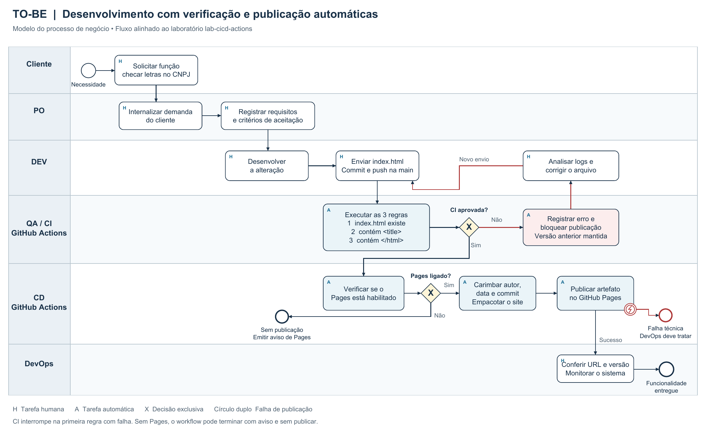

# Laboratório de automação de processos de desenvolvimento

Laboratório de automação de processos de desenvolvimento

Modelagem AS-IS e TO-BE • GitHub Actions e GitHub Pages • 29 de outubro de 2026

A proposta substitui conferências e publicação manuais por um fluxo que verifica cada envio de código e só publica quando as regras de CI são atendidas. A falha devolve o trabalho ao desenvolvedor, preservando a última versão publicada.

**Laboratório concluído:** repositório criado na conta JayZin65, Pages configurado, três cenários executados no GitHub Actions e site final publicado. A Versão 2 foi bloqueada e a Versão 1 permaneceu no ar até a publicação da Versão 3 corrigida.

[Repositório: github.com/JayZin65/lab-cicd-actions](https://github.com/JayZin65/lab-cicd-actions)
[Site: jayzin65.github.io/lab-cicd-actions/](https://jayzin65.github.io/lab-cicd-actions/)

## 1  Processo atual AS-IS

No desenho fornecido, o cliente solicita a função de checar letras no CNPJ. O PO internaliza a demanda e documenta a funcionalidade. O DEV desenvolve e entrega o código ao QA. O QA confere manualmente o arquivo, o título e a integridade do HTML. O DevOps entrega e implanta o código no ambiente, monitora o sistema e encerra a entrega.

Figura 1. Modelagem AS-IS fornecida no enunciado. O desenho não explicita uma decisão de rejeição e retorno à correção.

**Melhorias propostas:** eliminar a repetição manual das três conferências, registrar os resultados por execução e impedir a implantação quando alguma regra falhar.

## 2  Processo proposto TO-BE

O diagrama da página seguinte mantém as responsabilidades de negócio e acrescenta execução automática nas raias de CI e CD. O modelo descritivo também está disponível em BPMN editável.

| Etapa antiga | Etapa automatizada ou mantida |
| --- | --- |
| Cliente e PO definem a demanda | Atividade humana mantida; os requisitos orientam o desenvolvimento. |
| DEV entrega o código ao QA | DEV faz commit e push na main; esse evento inicia o workflow. |
| QA verifica arquivo, título e integridade | Actions executa as três condições em sequência. Uma falha interrompe a CI. |
| Decisão de liberar a implantação | O job publicar depende de verificar por needs: verificar. A falha faz a publicação ser ignorada. |
| DevOps transfere e implanta o código | Com Pages habilitado, Actions gera _site, preenche ator, data e commit, empacota e publica. |
| Monitoramento e entrega | DevOps confere a URL e a versão. Não há monitoramento contínuo automatizado neste workflow. |

Gatilhos e decisões

**Início:** push na branch main ou disparo manual por workflow_dispatch. Ambos executam as mesmas regras. Neste laboratório, as três versões foram acionadas por push.

**Reprovação:** registrar o erro, bloquear o deploy, analisar o log, corrigir o arquivo e fazer novo envio. No cenário 2, a Versão 1 permaneceu disponível.

**Pages desabilitado:** o workflow emite aviso e pula o deploy. Uma execução verde isolada não comprova publicação; é preciso conferir o passo de deploy e a URL. O Pages deste projeto está habilitado com origem GitHub Actions.

**Falha técnica de publicação:** DevOps investiga e corrige a configuração antes de uma nova tentativa. Não há rollback automático implementado. O bloqueio demonstrado ocorreu antes do deploy.

**Ajuste aplicado:** o job publicar declara environment: github-pages, com a URL de steps.publicar.outputs.page_url, seguindo a documentação oficial de publicação no Pages.

## 3  Regras e resultados reais no Actions

| Regra | Condição do workflow | O que verifica |
| --- | --- | --- |
| 1 | test -f index.html | Existência de um arquivo regular. |
| 2 | grep -qi "`<title>`" index.html | Presença literal da tag, sem diferenciar maiúsculas. |
| 3 | grep -qi "`</html>`" index.html | Presença do fechamento em qualquer posição. |
| Versão / commit | Verificação | Publicação | Resultado observado |
| 1 / 56eb380 | Sucesso | Sucesso | Site azul com Versão 1. |
| 2 / 515e9fb | Falha na regra 3 | Ignorada | Versão 1 permaneceu no ar. |
| 3 / ece782a | Sucesso | Sucesso | Site verde com Versão 3 corrigida. |

**Contagem didática:** duas execuções bem-sucedidas e uma falha esperada. Existe ainda uma execução inicial do template, bem-sucedida, fora dos três cenários. Portanto, no encerramento dos testes havia quatro execuções no histórico: três sucessos e uma falha.

[Versão 1: execução 40933187450](https://github.com/JayZin65/lab-cicd-actions/actions/runs/40933187450)

[Versão 2 — falha esperada: execução 40933736298](https://github.com/JayZin65/lab-cicd-actions/actions/runs/40933736298)

[Versão 3 — corrigida: execução 40990078154](https://github.com/JayZin65/lab-cicd-actions/actions/runs/40990078154)

Alcance da validação

Os jobs e seus passos foram consultados no GitHub. Na Versão 2, as regras 1 e 2 passaram, a regra 3 falhou e publicar foi ignorado. O site foi aberto após a falha e ainda exibia 56eb380. Após a Versão 3, a URL exibiu ece782a. As capturas e os registros JSON acompanham esta entrega.

As regras não validam todo o HTML nem a funcionalidade de CNPJ. Essa funcionalidade pertence à demanda de negócio do AS-IS; o laboratório implementa a automação sobre páginas de exemplo. Testes funcionais seriam uma ampliação futura.

Também foi realizada reprodução local das condições em Python, incluindo ausência de arquivo e ausência de título. O Bash local não pôde ser executado; a evidência principal é a execução real do workflow nos runners do GitHub.

## 4  Respostas às questões do laboratório

**1  Quais são as três regras?**
Verificar a existência de index.html e a presença de `<title>` e `</html>`. As duas buscas ignoram diferenças entre maiúsculas e minúsculas.

**2  Por que a Versão 1 permanece após o arquivo quebrado?**
A Versão 2 não contém `</html>`. A regra 3 falha e publicar, dependente de verificar, é ignorado. Sem novo deploy, o site mantém a versão anterior. Isso foi confirmado no Pages.

**3  O que poderia acontecer sem a verificação automática?**
O arquivo incompleto poderia substituir a versão válida caso a conferência manual não detectasse o problema. Isso poderia causar conteúdo incompleto ou comportamento inadequado; navegadores podem recuperar partes de HTML truncado, então a falha visual não é garantida.

**4  Quantas execuções deram certo e quantas falharam?**
Nos três cenários: duas deram certo e uma falhou intencionalmente. Incluindo a execução inicial do template, o histórico ao encerrar os testes tinha três sucessos e uma falha.

**5  Quem enviou, quando e qual o commit?**
O site final mostra JayZin65, 29/10/2026 às 23:10 e commit ece782a. O workflow preenche github.actor, a data da etapa de publicação no fuso America/Sao_Paulo e GITHUB_SHA abreviado. Esses dados permitem rastrear a entrega. O ator da execução não é necessariamente o autor original do código.

**6  Qual processo cotidiano pode usar a mesma ideia?**
Uma entrega acadêmica pode verificar automaticamente se o arquivo existe, se está no formato solicitado e se contém os campos obrigatórios antes de liberar o envio. Uma falha informa a pendência para correção.

Desafio do roteiro

O gatilho está em on → push → branches: [main] e em workflow_dispatch. As regras ficam no job verificar. A dependência que protege a publicação está em jobs → publicar → needs: verificar.

**Resultado da melhoria:** verificações repetíveis, rastreabilidade por execução e bloqueio comprovado de uma versão reprovada. Cliente e PO mantêm a definição da demanda; DEV corrige falhas; QA mantém e amplia os critérios; DevOps acompanha a entrega. Não foram medidos ganhos de tempo ou custos.

## 5  Evidências e fontes

As seis capturas na pasta evidencias registram o Actions e o site para cada cenário. A captura abaixo comprova a versão final publicada, com data, ator e revisão.

Figura 2. Site final publicado automaticamente após aprovação da Versão 3.

Fontes e rastreabilidade

[Roteiro e exemplos — Prof. Marcelino Dias da Silva, UNINOVE](https://github.com/MarcelinoDiasU9/lab-cicd-actions)

[Projeto realizado e documentação de entrega](https://github.com/JayZin65/lab-cicd-actions)

[Workflow aplicado no projeto](https://github.com/JayZin65/lab-cicd-actions/blob/main/.github/workflows/publicar-site.yml)

[GitHub Docs — dependências entre jobs](https://docs.github.com/en/actions/how-tos/write-workflows/choose-what-workflows-do/use-jobs)

[GitHub Docs — publicação com workflows no Pages](https://docs.github.com/en/pages/getting-started-with-github-pages/using-custom-workflows-with-github-pages)

Base consultada em 28/10/2026: revisão 742b74979d62c86685338d389cda6b5aabe442f9 do repositório do professor. Execução prática concluída em 29/10/2026. A imagem AS-IS foi fornecida no enunciado.

